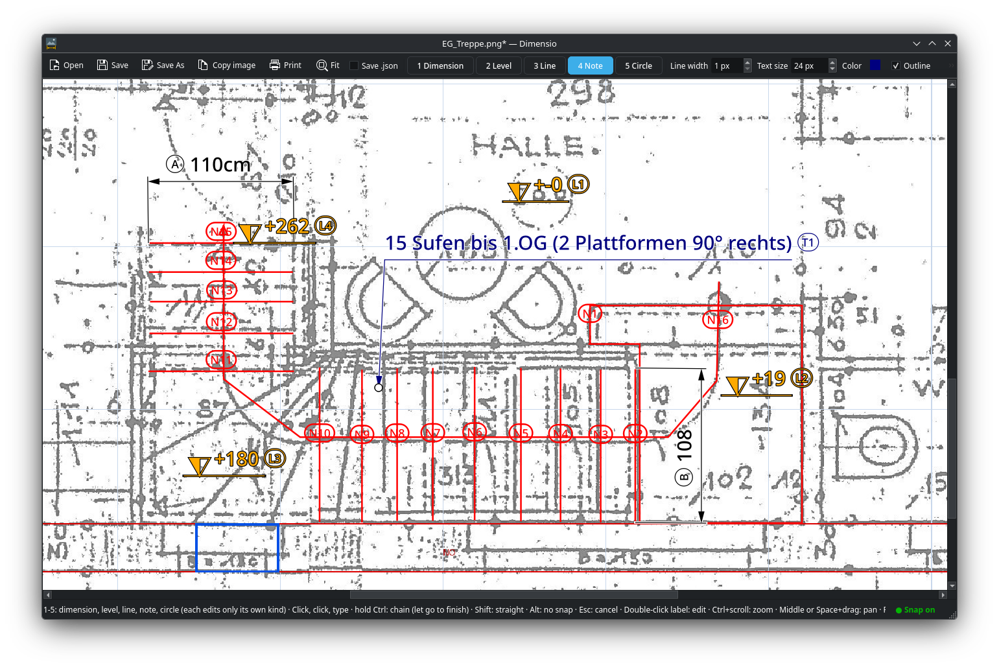
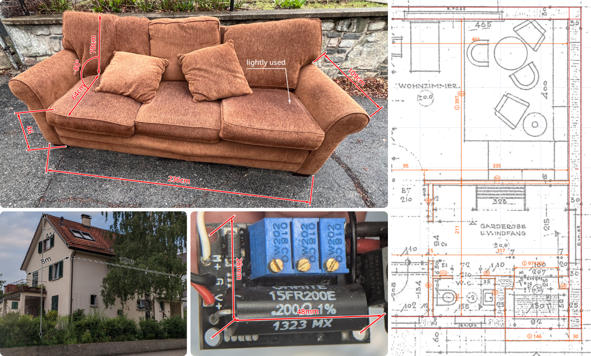

# Dimensio

Add dimension lines with **your own measurements** to photos — the way a technical drawing does
it, but on a picture of a sofa, a wall or a window opening. Click two points, type `284 cm`,
drag the line clear of the object. Done.



**Dimensio doesn't measure anything.** No scale, no calibration, no photogrammetry. You already
know your numbers from the tape measure, the plan or the datasheet. Dimensio is for *handing them
on*: the quickest way to put them on a picture so clearly that whoever gets it (a carpenter, a
friend, an AI drawing your house model) knows without asking which number belongs to which edge.



<sub>Sofa photo: [Bluestspruce](https://commons.wikimedia.org/wiki/File:Couch_left_on_a_curb.jpg), CC0, via Wikimedia Commons.</sub>

- Click, click, type: a dimension line with arrowheads and your label
- Drag the line anywhere; extension lines follow the drag direction, so dimensions sit naturally
  in perspective photos
- **Ctrl+click** for chains (`70 | 70 | 70 cm` along a wall)
- Optional angles: every corner of a chain can get an angle label (`35°`) with an arc — drawn
  only if you type something
- Level markers (`▽ ±0.00`, `+1.25 m`) for heights and terrain
- Plain lines, and one-line notes with an arrow pointing at what you mean ("drain pipe")
- Circles with a centre cross; type `Ø 40` for a diameter line or `R 20` for a radius line
- Snapping to existing points, lines and circles (always shown in the status bar)
- Text always lies along the line and is never upside down
- Each layer (dimensions, levels, lines, notes, circles) has its own color, line width and outline;
  text size, ID tags and which layers are shown apply to the whole picture
- Saves one flat `photo_dims.png` to send to people — opening either `photo.jpg` or the saved
  picture brings the editable lines back; **Save As** puts it anywhere, so the photo folder stays clean
- Copy the result straight to the clipboard

## Install

```bash
pipx install git+https://github.com/guelz/dimensio
# or
uv tool install git+https://github.com/guelz/dimensio
```

The first start adds Dimensio to your application menu and to **Open With** for images
(`dimensio --uninstall-desktop` removes it again).

**Native look (KDE/Breeze, HEIC/AVIF):** the PySide6 wheel from PyPI brings its own Qt, which
ignores your desktop theme and system image plugins. To use the system Qt instead (Arch example):

```bash
sudo pacman -S pyside6 kimageformats
pipx install --system-site-packages git+https://github.com/guelz/dimensio
```

## Use

| Do | How |
|---|---|
| Open | `dimensio photo.jpg`, Open With, drag and drop, Ctrl+O, or paste (Ctrl+V) |
| Tool | **1**/**D** dimension, **2**/**L** level marker, **3** line, **4**/**T** note, **5**/**C** circle (toolbar). Each tool is its own layer: it only selects, moves and edits its own kind, clicks go straight through everything else, and the toolbar's color / width / outline apply to that layer |
| Dimension | click A, click B, type the label, Enter |
| Chain | hold **Ctrl** and click every point; **let go of Ctrl** to finish (or Enter, or double-click the last point). Enter/Tab then walks the labels, Shift+Tab goes back |
| Angle | in a chain, Tab walks length → angle at the corner → length …; leave an angle empty to skip it |
| Level | with the level tool, click the spot and type its height; drag the marker away if it's in the way |
| Line | click, Ctrl+click for more points, click to finish; drag to move it |
| Note | click what you mean, type one line, Enter; drag the text where it fits |
| Circle | click the centre, click the edge; type `Ø 40` (diameter) or `R 20` (radius), or nothing for a plain circle |
| Snap | on by default: points land on nearby points, lines and circles (marker shows where); hold **Alt** to skip once, **S** or the status bar switch toggles it |
| Straight | hold Shift for horizontal or vertical |
| Move | with the matching tool active: drag it; drag a point's handle (select it first) |
| Edit text | double-click the label |
| Delete | select, Delete |
| Layers | **Layers** menu: tick off a kind to hide it — in the view *and* the saved picture (the `.dims.json` keeps it); picking its tool shows it again |
| Undo / redo | Ctrl+Z / Ctrl+Shift+Z |
| Zoom / pan | Ctrl+wheel, middle-drag or Space+drag, **F** fits the whole picture |
| Save | **Save** (Ctrl+S) → `photo_dims.png` next to the photo, or wherever you last saved this picture; **Save As** (Ctrl+Shift+S) to choose, it remembers the folder. Tick **Save .json** to also keep `photo.jpg.dims.json` next to the photo |
| Copy result | Ctrl+C |
| Print | **Print** (Ctrl+P): preview first; the picture fills the page, portrait or landscape to match |

## For scripts and AI assistants

Every saved PNG carries its dimension data as JSON inside the file (and in the optional `.dims.json`).
To be upfront about what that is: only what you can see in the picture — no hidden layers, no folder
paths — plus the original's file name and a checksum so Dimensio can find it again. Which export
belongs to which photo is remembered on your computer only, never in the file. It names every item (`A`, `B`, … for dimensions, `L1`, …
for levels, `N1`, … for lines, `T1`, … for notes — switch on **IDs** to tag them in the picture
too) and explains its own fields: pixel coordinates of every point, the text of every segment,
angle, level and note.

```bash
dimensio --data photo_dims.png    # print it
```

So when you hand a picture to an AI model, it doesn't have to guess which number belongs to which
edge; it can read both the picture and the exact geometry.

## Develop

```bash
uv venv && uv pip install -e '.[dev]'
QT_QPA_PLATFORM=offscreen .venv/bin/pytest
```

## License

MIT
